# Sitio estático con distribución global

Despliegue de un sitio web statico mediante Amazon S3 y Amazon CloudFront, con un enfoque en la seguridad, disponibilidad, rendimiento y el costo.

## Limitaciones

El uso de Route53 para el registro de dominios esta deshabilitado para las cuentas **free tier**, asi que hare la omisión de el uso de Route53 y ACM.

## Alcances

El laboratorio pretende la creacion de red de distribucion de contenido, la cual accede a los objetos de un bucket S3.

- Creacion de usuarios, roles y politicas mediante IAM.
- Creacion de CDN con CloudFront.
- Creacion de un bucket S3 con el sitio estatico a distribuir.
- Captura de logs mediante CloudWatch.

## Arquitectura propuesta

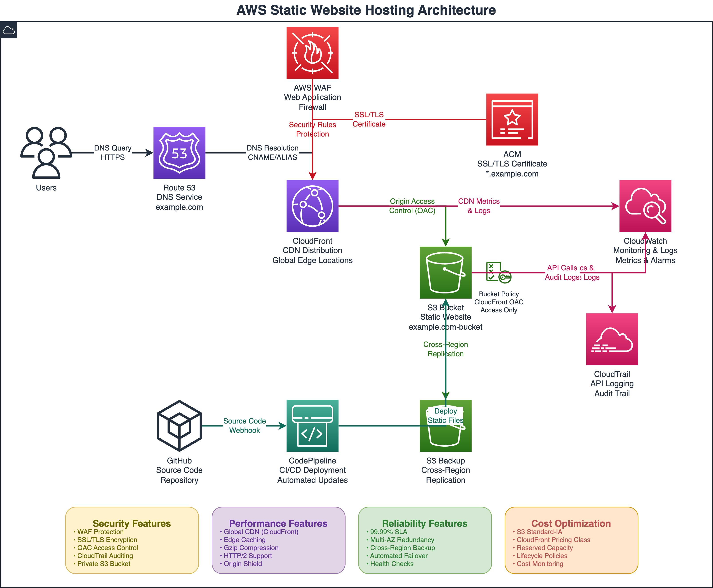

## Flujo de peticion

1. El usuario hace la peticion a traves de CloudFront.
2. CloudFront revisa si tiene en cache el objeto requerido.
3. Si es necesario, CloudFront realiza la peticion a S3.
4. OAC firma la peticion.
5. La politica del bucket S3 permite la lectura solo de las fuentes autorizadas (CloudFront).

## Servicios AWS

|Servicio|Proposito|
|---|---|
|S3|Almacenamiento de objetos|
|CloudFront|Red de entrega de contenido y cache|
|Origin Access Control|Acceso seguro desde CloudFront a S3|
|AWS IAM|Servicio de control de acceso|

## Despliegue

### Creacion del bucket S3

Creacion de un bucket de proposito general, la propiedad del objeto (ACL) esta dishabilitada y bloquea por defecto el acceso publico al bucket creado en la region de us-east-1.

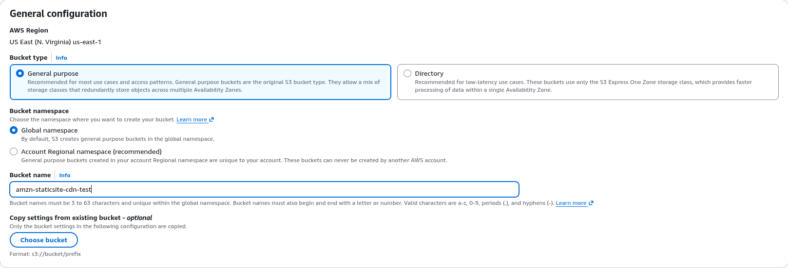

Carga de los archivos del sitio estatico al bucket S3.
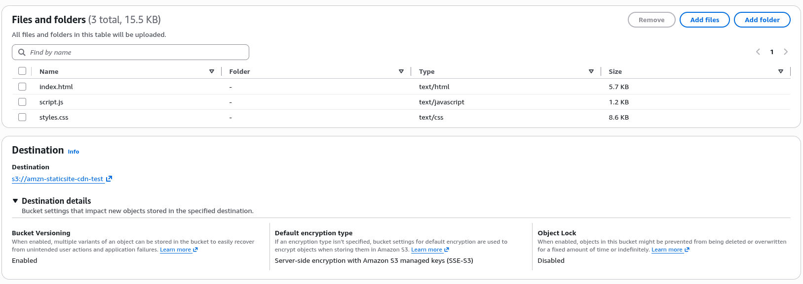

Creacion de una politica de ciclo de vida para el bucket, despues de 15 dias cambia el tipo de bucket.
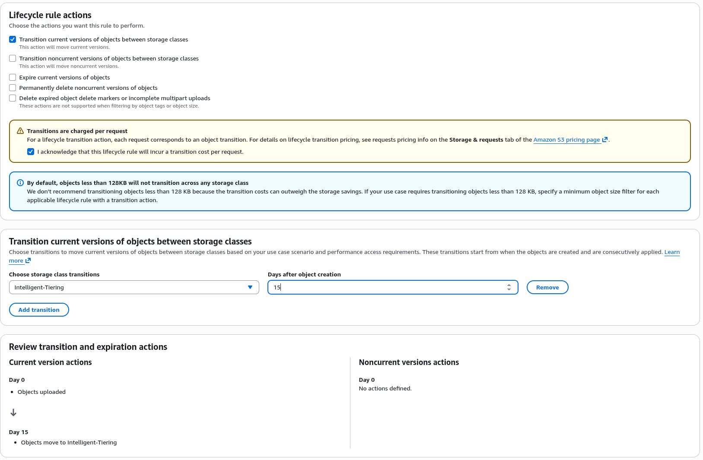

Creacion de la politica del bucket.
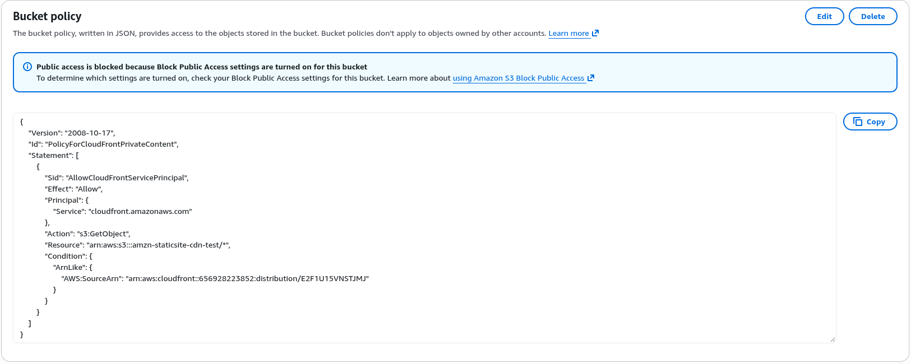

### Creacion de CDN con CloudFront
Configuracion de CDN mediante CloudFront.
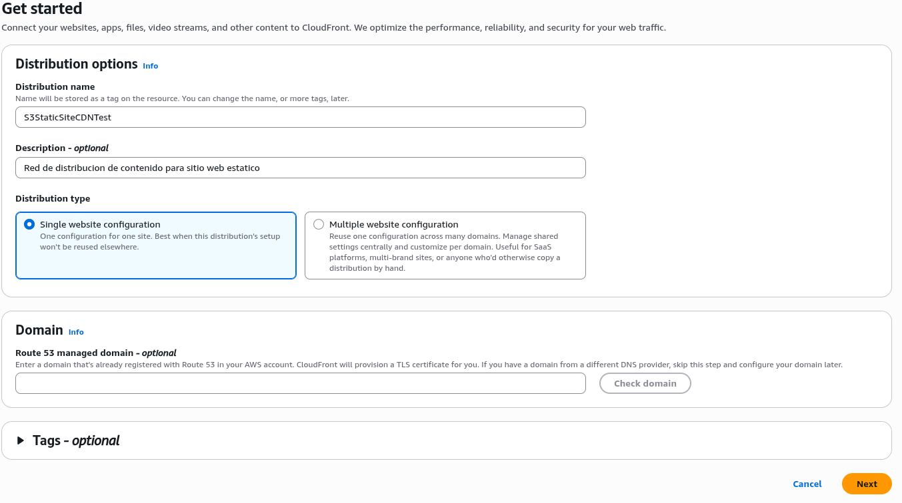
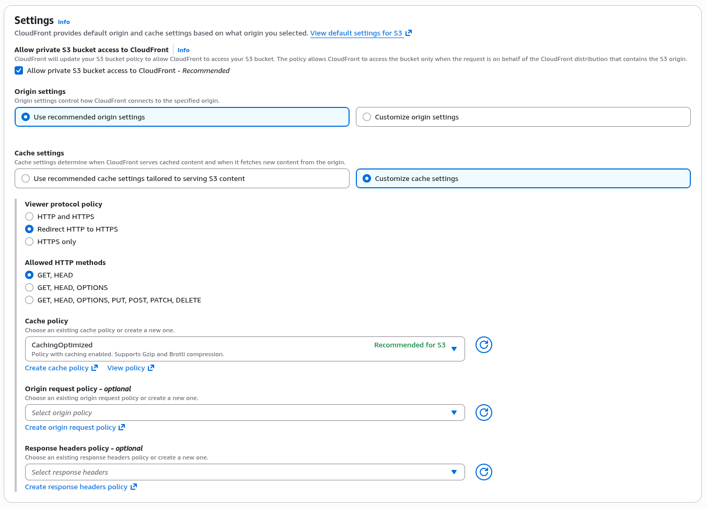

Configuracion de Firewall para aplicaciones web.
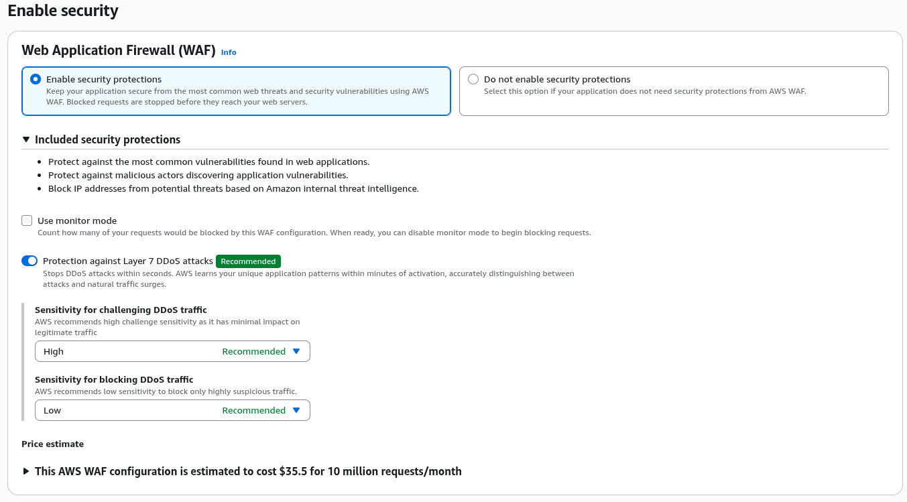

Origen de los datos a ser servidos a la red de distribucion.
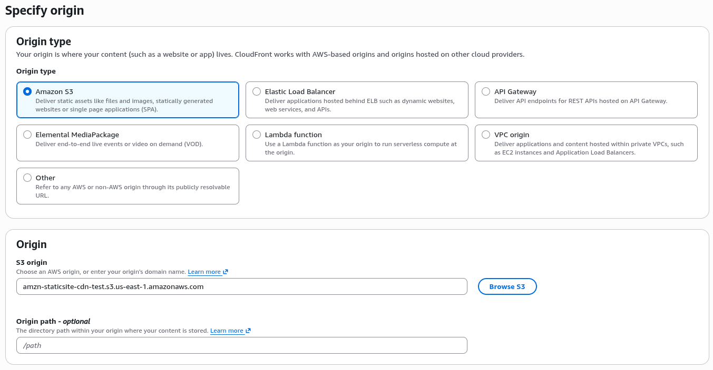

Definición del origen del sitio estatico. 
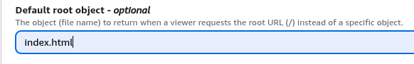

### Sitio estatico.

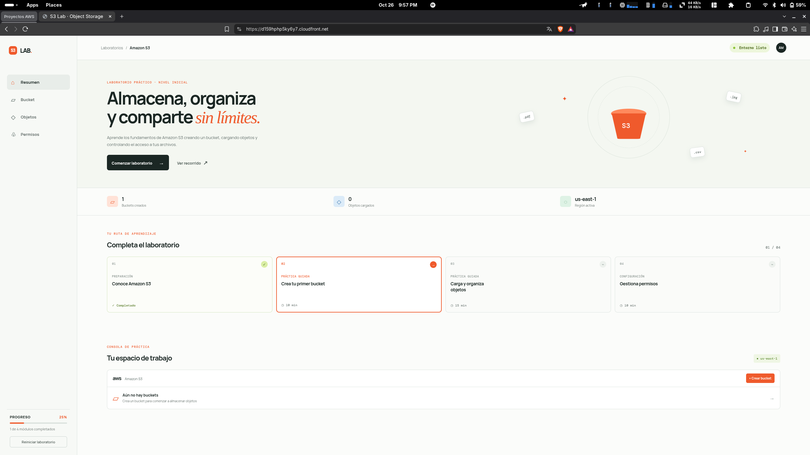

### Monitoreo con CloudWatch